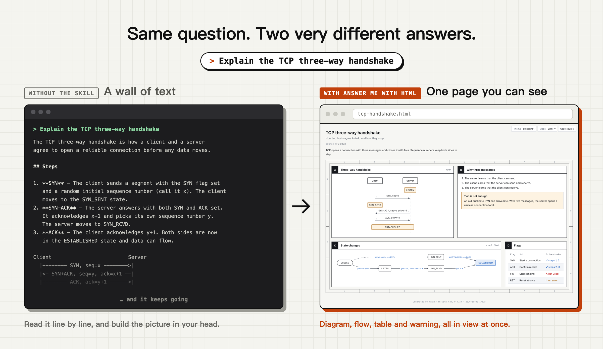
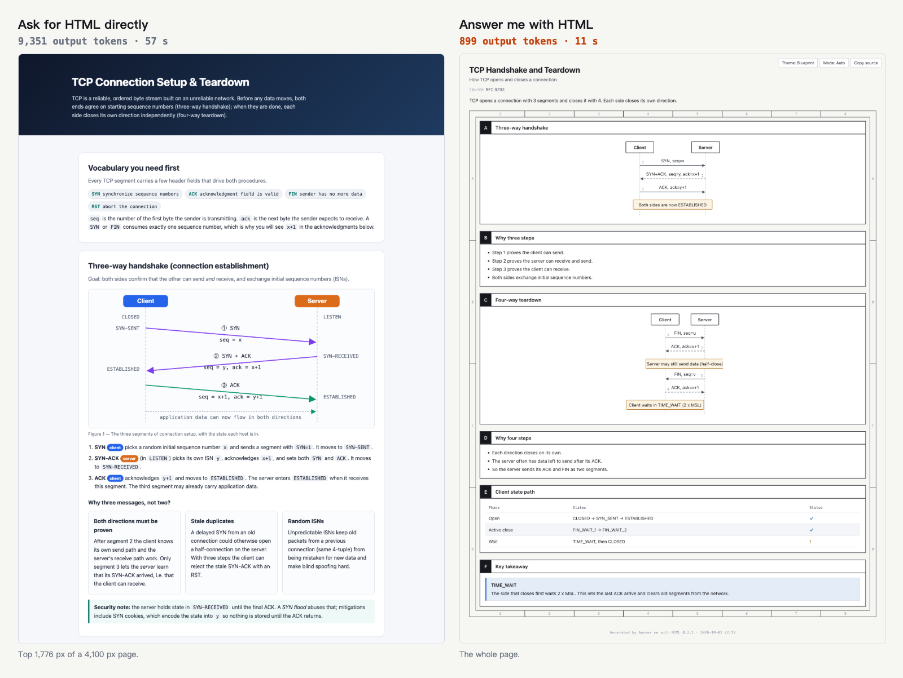
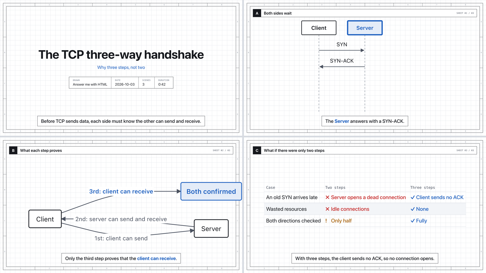
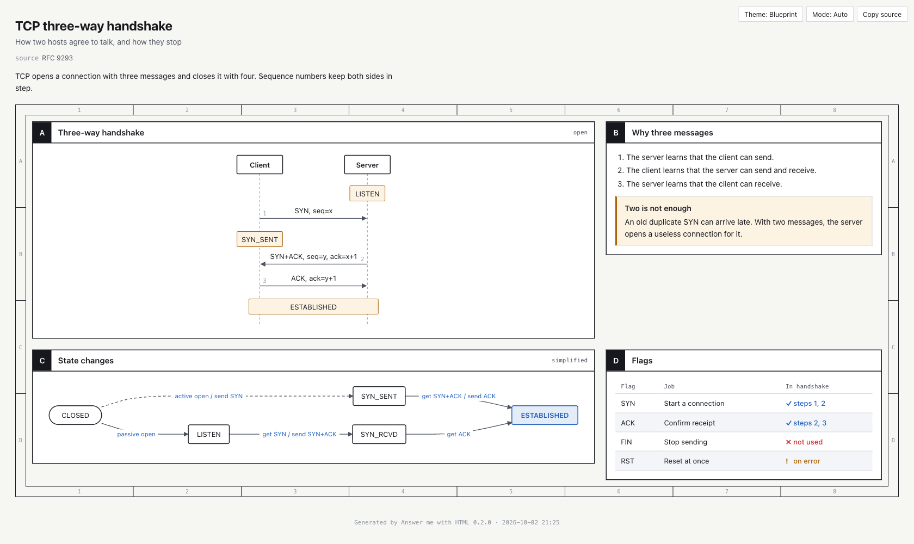
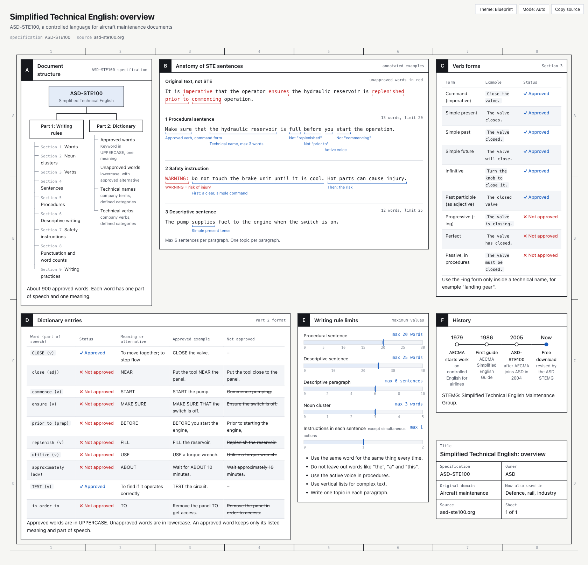
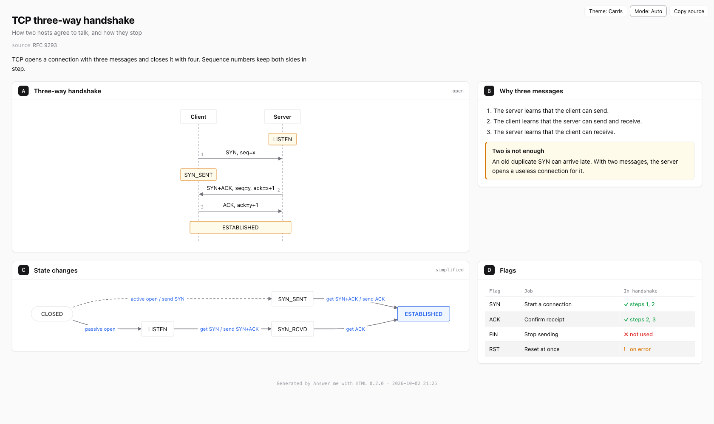

> **[中文化] answer-me-with-html**
>
> 此项目是 [QingYunA/answer-me-with-html](https://github.com/QingYunA/answer-me-with-html) 的中文翻译版本。
> - 原项目 Stars: 2402
> - 主语言: JavaScript
> - 许可证: MIT
> - 翻译日期: 2026-10-09
> - 原始 README: [README_en.md](README_en.md)
>
> 说明：下方 README 正文为**原项目文档的中文翻译**，力求忠于原文；本页顶部的「中文快速上手」为**面向中文用户的补充导读**（非原文内容），目的是让你不用读完整篇 README 就能先把项目跑起来。
>
> 如有翻译不准确之处，欢迎提 Issue 或 PR。

---


## 🚀 中文快速上手（补充导读，非原文）

### 这是什么 / 解决什么问题

Answer me with HTML 是一个「agent skill」（智能体技能），用来把难以用纯文字讲清的问题，变成一页可读的 HTML 页面。它解决的是「模型直接输出一大段终端文字、难以阅读」的痛点：模型只写一份简短的 Markdown 草稿，交给技能自带的 CLI 生成页面，官方称模型输出的 token 约为手写 HTML 的 1/8。它支持 Claude Code、Codex、Cursor、OpenCode、Pi 等 agent。

### 快速上手（最短路径）

1. 确认已安装 Node.js 20 或更高版本（原文说明：没有 `npm install` 步骤，CLI 已打包在技能内）。
2. 推荐让 agent 自己安装：把下面这句话粘贴进 Claude Code、Codex、Cursor、OpenCode 或其他 agent：
   > Install Answer me with HTML: read https://raw.githubusercontent.com/QingYunA/answer-me-with-html/main/INSTALL.md and follow it.
3. 如果 agent 打不开链接，改用命令（`<your agent name>` 换成你的 agent，Claude Code 用 `claude-code`）：
   ```bash
   npx -y skills add QingYunA/answer-me-with-html -g -y -a <your agent name>
   ```
4. 或者在 Claude Code 内用插件方式安装：
   ```
   /plugin marketplace add QingYunA/answer-me-with-html
   /plugin install answer-me-with-html@answer-me-with-html
   ```
5. 安装后无需额外配置，直接像平时一样提问即可，例如：
   ```
   > Explain the TCP three-way handshake
   > Map out how the modules in this repo fit together
   > Redis or Memcached for our cache?
   ```
6. （可选）原文推荐开启 always-on mode，让 agent 对每个结论都附上页面，而不只是难题；原文称只需在规则文件里加一条规则，具体写法原文未说明。

### 环境要求

- 操作系统：原文未说明（未列出支持的系统）。
- 硬件：原文未说明。
- 依赖：需要 Node.js 20 或更高版本（`package.json` 的 `engines` 同样为 `node >=20`）；运行时依赖为 `@dagrejs/dagre` 和 `marked`，但原文说明无需执行 `npm install`。
- 版本要求：Node.js 20+。
- 国内网络提示：安装命令会从 GitHub / npm 拉取内容，国内网络可能需要更换镜像源或加速下载（原文未说明具体镜像方案）。

### 常见坑与注意事项

- 需要 Node.js 20 或更高版本，低于此版本无法运行。
- 安装依赖 agent 能访问外链；若 agent 打不开链接，需改用 `npx` 命令方式安装。
- 它并非对所有问题都生成页面：原文举例说明，像「How do I show hidden files with `ls`?」这类一句话问题，只会得到一行回答，不生成页面。
- 原文未说明是否需要 API Key、是否需要下载大文件；除 Node.js 版本外，暂无明显坑点。

---


---

<p align="center">
  
</p>

<h1 align="center">Answer me with HTML</h1>

<p align="center">
  <b>极速&nbsp;&nbsp;|&nbsp;&nbsp;ASD-STE100&nbsp;&nbsp;|&nbsp;&nbsp;讲解视频&nbsp;&nbsp;|&nbsp;&nbsp;单文件，离线可用</b>
</p>

<p align="center">
  <b>一个 agent 技能。提出一个难题，得到的是一个真正能读的页面，而不是一大段文字。<br>模型只需写出它手写 HTML 所需 token 的约 1/8。</b>
</p>

<p align="center">
  <a href="https://github.com/QingYunA/answer-me-with-html/releases"></a>
  <a href="https://github.com/QingYunA/answer-me-with-html/stargazers"></a>
  
  <a href="https://www.theagenticleaderboard.com/alternatives/answer-me-with-html/"></a>
</p>

<p align="center">
  <a href="https://answer-me-with-html.com/"><b>网站</b></a> · <a href="#install">安装</a> · <a href="#what-you-ask-what-you-get">示例</a> · <a href="#explainer-videos">视频</a> · <a href="#always-on-mode-recommended">常开模式</a> · <a href="docs/reference.md">参考</a> · <a href="README.zh-CN.md">简体中文</a>
</p>

<p align="center">
  
</p>

安装后，像往常一样提问即可：

```
> Explain the TCP three-way handshake
> Map out how the modules in this repo fit together
> Redis or Memcached for our cache?
```

agent 会写一份简短的 Markdown 草稿，并交给技能自带的 CLI。约 50 毫秒后，你就得到了一个页面：

https://github.com/user-attachments/assets/d3063a28-5dfd-4c44-a562-be901c49b249

<p align="center"><sub>24 秒演示。打开声音可听配乐。</sub></p>

## 为什么不直接要求 HTML？

你可以这么做。现在的模型能写出不错的 HTML。但它们写的大部分内容并非正文。我们统计了模型手写的 9 个页面的 token，平均 4,893 个：

| 页面组成部分 | 占比 | 使用本技能 |
| :--- | ---: | :--- |
| SVG 图表：坐标和路径 | 47% | 由 CLI 生成 |
| CSS | 15% | 由 CLI 生成 |
| HTML 标签 | 17% | 由 CLI 生成 |
| 文本 | 21% | 由模型以 Markdown 形式编写 |

使用本技能时，模型只写一份 Markdown 草稿。对于相同的问题，平均为 612 个 token，**约为手写 HTML 的 1/8**。写得少意味着等待时间更短（3 个主题 × 3 次运行，取中位数，Claude Sonnet 5.5，普通 Claude Code 配置）：

| | 直接要求 HTML | Answer me with HTML | |
| :--- | ---: | ---: | :--- |
| 模型写出的 token | 4,893 | **612** | **少 8 倍** |
| 时间 | 31 秒 | **12 秒** | **快 2.6 倍** |

<p align="center">
  
</p>

<p align="center"><sub>同一个问题，同一个模型，两种回答方式。两个页面都可用。</sub></p>

token 计数保存在 [bench/corpus/tokens.json](bench/corpus/tokens.json) 中，因此 `node bench/corpus.mjs` 每次都会给出相同的数字。页面本身可[下载](https://github.com/QingYunA/answer-me-with-html/releases/download/v0.4.14/bench-corpus-2026-10-07.zip)。账单的下降幅度小于写作量的下降，这里约为 15%，因为每一轮对话无论是否使用本技能，都会读取系统提示、你的问题和对话历史。参见[成本去向](bench/README.md#where-the-cost-goes)。

讲解视频节省得更多：在[一项小测试](bench/README.md#explainer-videos)中，输出 token 约减少 18 倍，速度快 12 倍。

## 安装

你需要 [Node.js](https://nodejs.org/) 20 或更高版本。无需 `npm install` 步骤。CLI 已打包在技能内部。

### 让你的 agent 来安装（推荐）

将以下内容粘贴到 Claude Code、Codex、Cursor、OpenCode 或任何其他 agent 中：

> Install Answer me with HTML: read https://raw.githubusercontent.com/QingYunA/answer-me-with-html/main/INSTALL.md and follow it.

[INSTALL.md](INSTALL.md) 是为 agent 编写的。它会在 Claude Code 中安装插件，在其他 agent 中安装技能，保留已有安装，不向你询问任何问题，并在用 TCP 三次握手页面验证结果后给出唯一一份报告。如果你的 agent 无法打开链接，请使用 `npx -y skills add QingYunA/answer-me-with-html -g -y -a <your agent name>`（对于 Claude Code，使用 `-a claude-code`）。

### Claude Code 插件

在 Claude Code 中运行：

```
/plugin marketplace add QingYunA/answer-me-with-html
/plugin install answer-me-with-html@answer-me-with-html
```

### 一条命令

```bash
npx skills add QingYunA/answer-me-with-html
```

它会询问要安装到哪些 agent。安装器 [vercel-labs/skills](https://github.com/vercel-labs/skills) 支持 70 多个 agent。

<details>
<summary>手动安装</summary>

将 `skills/answer-me-with-html` 文件夹复制到你的 agent 的技能文件夹中。对于 Claude Code：

```bash
git clone --depth 1 https://github.com/QingYunA/answer-me-with-html.git /tmp/answer-me-with-html
cp -R /tmp/answer-me-with-html/skills/answer-me-with-html ~/.claude/skills/answer-me-with-html
```

其他 agent 的技能文件夹：Codex `~/.codex/skills/`，Cursor `~/.cursor/skills/`，OpenCode `~/.config/opencode/skill/`。

</details>

安装后无需任何设置。**我们建议开启[常开模式](#always-on-mode-recommended)**：这样 agent 会为每个结论附加一个页面，而不仅仅是难题。只需在你的规则文件中添加一条规则。

## 你问什么，就得到什么

| 你问 | 你得到 |
| :--- | :--- |
| "Explain the TCP three-way handshake" | 一张时序图、一张状态图和一张标志位表 |
| "How are the modules in this repo organized?" | 一棵文件夹树加一张调用图 |
| "Redis or Memcached?" | 一张带 ✓ 和 ✗ 的对比表，然后是结论 |
| "What's wrong with this paragraph?" | 逐句注释，标出有问题的词和修改建议 |
| "How did Kubernetes come about?" | 一条突出关键时刻的时间线 |
| "Plan the cache change" | 来自你文件中的真实代码，以及以页面选项形式呈现的待定决策，供你作答 |
| "How do I show hidden files with `ls`?" | 不生成页面。一行问题得到一行回答 |

agent 会判断何时值得生成页面：相关概念、多步骤流程、多方案对比。你也可以直接说"用 HTML 解释"。

页面保存在 `~/.answer-me-with-html/pages/` 中。右上角的按钮可切换主题和明暗模式、收集你的回复，以及复制生成该页面的 Markdown。

## 这与 Archify 或 GenUI 插件有何不同？

[Archify](https://github.com/tt-a1i/archify) 根据 JSON 规范生成一张交互式图表。诸如 [dsh-genui](https://github.com/omdsh-dev/dsh-genui) 的 GenUI 插件在一个聊天应用内展示组件。本技能将整个问题作为一个页面来回答：文本、表格、代码和图表，源自一份 Markdown 草稿，可在任何能运行 shell 命令的 agent 中使用。参见[完整对比](docs/compare.md)。

## 讲解视频

Karpathy 理解 LLM 输出的阶梯最终指向讲解视频。用 3Blue1Brown 风格要求一个："make a 3b1b-style video on the TCP handshake"。

<p align="center"></p>

agent 写的草稿与页面相同，只是每个节拍多一行旁白。仅此而已：

````markdown
## Both sides wait
```sequence
Client -> Server: SYN
Server -> Client: SYN-ACK
```
> The client sends a SYN to ask for a connection.
> The [Server] answers with a SYN-ACK.
````

`am video` 会将其转换为播放器页面。图表随旁白逐步构建，镜头跟随方括号中指定的节点。语音内嵌在页面中，因此可离线播放。播放器有章节条可在场景间跳转、一个速度按钮，以及一个导出按钮，可在浏览器中编码视频并下载（本地文件或 `localhost`，无需 ffmpeg）。添加 `--mp4` 可导出 MP4 文件（需要 ffmpeg），或添加 `--webm` 可导出由页面自行编码的 WebM 文件（无需 ffmpeg）。agent 仅在你要求时才制作视频。详情：[视频指南](docs/video.md)。

## 设置

通过斜杠命令更改设置。无需手动编辑配置文件。

| 位置 | 方法 |
| :--- | :--- |
| Claude Code（插件安装） | `/answer-me-with-html:config` 会询问要更改什么。`/answer-me-with-html:config open off` 直接更改 |
| 任意 agent | `/answer-me-with-html config open off`，或直接说"stop opening the browser" |
| 终端 | `am config` 查看，`am config set open off` 更改，`am config reset` 恢复默认值 |

设置项包括 `open`（在浏览器中打开页面）、`theme`、`mode`（明或暗）、`style`（写作检查）、`update_check` 和 `voice`（视频旁白）。默认值和取值：[参考](docs/reference.md#settings)。

## 常开模式（推荐）

开启常开模式后，**每个结论都附带一个页面**：每当 agent 给出结论、摘要、计划或对比，即使很短，它都会附加一个含 2 到 4 个面板的小页面，并在回复末尾附上路径。这些页面从不自动弹出，因此不会打扰你。闲聊和没有结论的回复保持原样。Claude Code 在计划模式下不生成页面。

默认关闭。我们推荐开启：你无需再主动要求页面，短回答也能像长回答一样易读。页面会堆积在 `~/.answer-me-with-html/` 中；用 `am clean` 清理。要开启它，请将以下内容粘贴给你的 agent，让它把规则写入其规则文件，如 `~/.claude/CLAUDE.md` 或 `AGENTS.md`：

> Turn on always-on mode for Answer me with HTML: add a global rule — "[answer-me-with-html always-on] Whenever a reply gives a conclusion, summary, plan, comparison, review or explanation, even a short one, also make a page with the answer-me-with-html skill (2 to 4 panels for routine answers), render it with --no-open before you write the reply, and end the reply with a file:// link to the page. Skip casual chat, one- or two-sentence replies with no conclusion, pure command output, and requests for plain text."

要关闭它，删除该规则即可。想要更少的页面？参见[减少主动生成](docs/reference.md#less-proactive)。

## 更新与清理

更新是手动的。每周 agent 会检查 GitHub 上的新版本号并告知你；不会发送任何关于你的信息。要更新，告诉你的 agent "update answer-me-with-html"。页面会堆积在 `~/.answer-me-with-html/` 中。说"clean up the pages"，agent 会在删除任何内容前询问你。其他安装方式和所有选项：[参考](docs/reference.md#updating-and-cleaning-up)。

## 背景

Andrej Karpathy [发帖](https://x.com/karpathy/status/2105819303471976479)指出，随着 LLM 承担越来越多的工作，跟上它们的输出成为难点。一张图表或一个网页远比一大段文字更容易理解。

我尝试过直接让 agent 用 HTML 回答。页面不错，但很慢：一个像样的页面需要一两分钟，主要是数百行几乎每次都相同的 CSS。图表更糟。模型必须手动计算 SVG 坐标，箭头常常指向空处。

因此 Answer me with HTML 把这部分工作从模型手中拿走。模型写内容。CLI 负责布局、颜色和绘图。

## 工作原理

这就是模型所写的全部内容：

````markdown
---
title: TCP three-way handshake
---
## A Three-way handshake {span=2}
```sequence num
Client -> Server: SYN, seq=x
Server -> Client: SYN+ACK, seq=y, ack=x+1
Client -> Server: ACK, ack=y+1
note Client, Server: ESTABLISHED
```

## C State changes {span=2}
```flow LR
(CLOSED) -> LISTEN: passive open
LISTEN -> SYN_RCVD: get SYN / send SYN+ACK
SYN_RCVD -> *ESTABLISHED: get ACK
```
````

其余由 CLI 完成。它选择模板、放置面板、应用主题、用 [dagre](https://github.com/dagrejs/dagre) 布局流程图，并按标签宽度为时序图留出间距。完整草稿 [examples/tcp.en.md](examples/tcp.en.md) 会变成这个页面：

<p align="center">
  
</p>

## 特性

- **由代码布局：** 面板位置和图表坐标是计算出来的，而非猜测。标签不会被截断，网格中也没有空隙。
- **自我纠错：** 当草稿有错误时，CLI 会返回行号、组件和一个正确示例。agent 一次即可修正。
- **三种主题：** `blueprint` 看起来像工程图纸，`shadcn` 使用简洁卡片，`paper` 适合长文阅读。默认情况下 CLI 为长文本选择 paper，为图表选择 blueprint。所有主题都有明暗模式，你也可以添加自己的主题。
- **单文件，无依赖：** 每个页面都是一个单独的 `.html`，没有 CDN 链接或网络字体。可离线打开，易于分享。
- **语言：** 中文（简体和繁体）、英文和日文有各自的按钮和字体。其他语言使用英文按钮。参见[语言](docs/reference.md#languages)。
- **写作检查：** 草稿会根据改编自 ASD-STE100 的规则进行检查：长句、冗词、被动语态。除非你要求严格模式，否则只发出警告。
- **真实代码，而非重新录入：** 代码块可以引用你文件中的行（`src=` `lines=`），因此页面上的代码是真实代码。文件夹之外的文件和包含密钥的文件会被拒绝。
- **在页面上作答：** 可对任何面板发表评论，并在 agent 提出的决策（`ask`）中选择选项。Reply 按钮会将你的答案和评论整合成一条消息，供你粘贴回 agent。
- **保留其源文件：** 每个页面都内嵌了生成它的 Markdown。点击"Copy source"即可取回。

<table>
  <tr>
    <td width="50%"></td>
    <td width="50%"></td>
  </tr>
  <tr>
    <td align="center"><sub>Blueprint 主题（<a href="examples/ste100.md">examples/ste100.md</a>）</sub></td>
    <td align="center"><sub>shadcn 主题，暗色模式</sub></td>
  </tr>
</table>

## 组件

agent 根据信息的形态选择组件：

| 组件 | 适用场景 |
| :--- | :--- |
| `flow` | 架构、调用链、